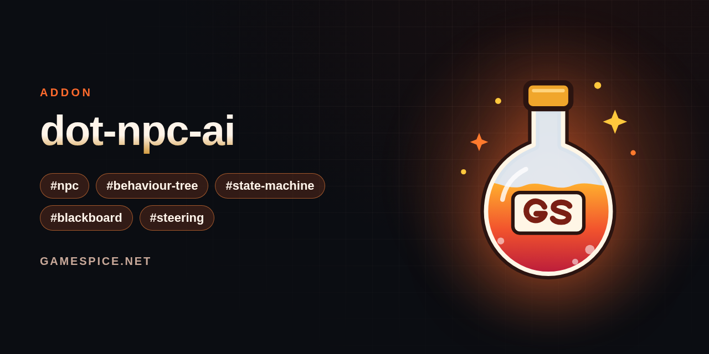

[](https://moddingcommunity.com/a/228-dot-npc-ai)

How NPCs make decisions in a Godot 4 game. It is the decision half of [dot-npc](https://github.com/gamespice-platform/npc): you describe what an NPC does with a behaviour tree, a state machine, or a score-based (utility) chooser, and dot-npc-ai runs it. It also gives each NPC a character (so two NPCs on one tree behave differently), squad tactics, hearing, cover, shooting, and steering for crowds. Part of TMC's open source **Gamespice** collection (MIT licence).

> Built with Claude Code. Every addon has a headless test suite and the suites pass, but little of this has met real players yet. Please report rough edges.

## Install

Copy `addons/dot_npc_ai/`, `addons/dot_npc/` and [dot-core](https://github.com/gamespice-platform/core)'s `addons/dot_core/` into your project and enable them under **Project > Project Settings > Plugins**. Only the brain class touches dot-npc.

## What is in it

| Piece | What it does | More |
| --- | --- | --- |
| Behaviour tree (`DotNpcAiSelector`, `DotNpcAiSequence`, `DotNpcAiLeaf`, decorators, `DotNpcAiParallel`) | Picks what to do each tick and remembers what was running. | [docs/decisions.md](docs/decisions.md) |
| State machine (`DotNpcAiMachine`, `DotNpcAiState`) | For NPCs that are simpler than a tree. | [docs/decisions.md](docs/decisions.md) |
| Blackboard (`DotNpcAiBlackboard`) | Per-NPC memory whose entries expire. | [docs/decisions.md](docs/decisions.md) |
| Utility scoring (`DotNpcAiUtility`, `DotNpcAiCurve`, `DotNpcAiPersonality`) | Scores actions with response curves and picks one without flip-flopping. | [docs/utility.md](docs/utility.md) |
| Character and skill (`DotNpcAiCharacter`, `DotNpcAiSkill`) | Per-NPC reaction time, aim, memory, aggression. Server-wide difficulty. | [docs/character.md](docs/character.md) |
| Tactics (`DotNpcAiSquads`, `DotNpcAiSounds`, `DotNpcAiMemory`, `DotNpcAiHeatmap`) | Squads, hearing, cover, shooting, learned player routes. | [docs/tactics.md](docs/tactics.md) |
| Steering and avoidance (`DotNpcAiSteering`, `DotNpcAiAvoidance`, `DotNpcAiCrowdGrid`) | Spacing and local avoidance for crowds. Opt in. | [docs/avoidance.md](docs/avoidance.md) |
| Scheduler (`DotNpcAiScheduler`) | Thinks less often for NPCs far from players. Opt in. | [docs/scheduler.md](docs/scheduler.md) |
| Map annotation (`DotNpcAiNavAnnotator`) | Finds jump and drop links, cover, hiding spots and chokepoints from a baked navigation mesh. | [docs/navigation-annotations.md](docs/navigation-annotations.md) |

## Quick start

```gdscript
extends "res://addons/dot_npc_ai/runtime/dot_npc_ai_brain.gd"

func _build() -> void:
    initial_state = &"idle"

    machine = DotNpcAiMachine.new()
    machine.add(DotNpcAiState.make(&"idle")
        .when(func(_c): return npc.has_target(), &"chasing"))
    machine.add(DotNpcAiState.make(&"chasing")
        .when(func(_c): return not npc.has_target(), &"searching"))
    machine.add(DotNpcAiState.make(&"searching")
        .when(func(_c): return npc.has_target(), &"chasing")
        .after(3.0, &"idle"))

    tree = DotNpcAiSelector.new(&"root", [
        DotNpcAiSequence.reactive_with(&"chase", [
            DotNpcAiLeaf.Condition.new(&"has a target", func(_c): return npc.has_target()),
            DotNpcAiLeaf.Action.new(&"walk at it", _chase),
        ]),
        DotNpcAiLeaf.Action.new(&"wander", _wander),
    ])

func _chase(ctx: DotNpcAiContext) -> int:
    ctx.put(&"last_seen", target_position(), 6.0)      # remembered for six seconds
    steer_with_spacing(target_position(), 4.0, ctx.delta)
    return DotNpcAiNode.Status.RUNNING
```

## Two rules to know

1. **A node that returned RUNNING is resumed next tick, not restarted.** The composites keep the resume position and `tick()` cannot be overridden, so you cannot get this wrong by accident.
2. **A check followed by an action that never finishes needs a reactive sequence.** Use `DotNpcAiSequence.reactive_with()` so the check is asked again every tick. A plain sequence is for steps done in order.

## Characters and difficulty

A tree decides what an NPC does. A `DotNpcAiCharacter` decides how well. It sets reaction time, alertness, memory, aim accuracy and skill, turn rate, aggression, self-preservation, vengefulness, camping and tactics. Presets: `easy()`, `normal()`, `hard()`, `nightmare()`.

```gdscript
brain.character = DotNpcAiCharacter.hard().with_seed(npc.instance_id)

# In the "shoot at it" branch:
if not ctx.has_reacted(npc.target_since):   # use target_since, not engaged_at
    return DotNpcAiNode.Status.RUNNING       # seen it, not acted on it yet
var at := ctx.character.aim_point(muzzle, target.position, target.velocity, 900.0, shot)
```

A catalogue can name a preset in a definition's `meta`, for example `"skill": "hard"`. All randomness is a hash of the character's seed and a number you pass, so the same shot always misses the same way and a replay matches the server. Give each NPC its own seed.

### Server difficulty

`DotNpcAiSkill` lets a server operator make every NPC smarter or slower without editing catalogues. It moves each character toward the easy or nightmare preset instead of replacing it, and live NPCs pick the change up on their next tick. Personality is never changed.

| Cvar | Default | What it does |
| --- | --- | --- |
| `npc_skill` | `0` | `easy`, `normal`, `hard`, `nightmare`, or a number from -1 to 1 (values outside are clamped). 0 is as authored. |
| `npc_reaction_scale` | `1` | Multiplies every reaction time. 0.5 reacts twice as fast. |
| `npc_reaction_min` | `0.05` | Lowest reaction time in seconds. 0 allows instant reactions. NPCs authored with no reaction time are left alone. |

```gdscript
game.npc_skill.bind_cvars(add_cvar, DotConVar.FLAG_NOTIFY)   # in a dot-server module, once
game.npc_skill.attach(spawner)                               # before the first spawn
```

dot-server is not required: `bind_cvars` accepts any function shaped like `add_cvar`.

## Tactics

Attach a `DotNpcAiSquads` and a `DotNpcAiSounds` to the spawner and name a squad in a definition's `meta`. Every `DotNpcAiBrain` then, with no game code:

- turns what it senses into conditions (`SEE_ENEMY`, `NEW_ENEMY`, `LOST_ENEMY`, `LOW_HEALTH`, `HEAR_COMBAT`, `HAS_ATTACK_SLOT` and others) that guards and interrupts can read;
- remembers several enemies: where, how it knows, how fast they moved, who hurt it;
- hears gunfire, footsteps and danger, scaled by its alertness;
- calls out what it sees so squadmates come to help;
- turns no faster than its character allows.

Ready-made leaves for your tree: `flee_danger`, `surround`, `search`, `find_cover` and `take_cover`, `ready_to_fire`, `aim_solution`, `hold_range`, `claim_role` and `patrol_hot`. Only a squad's attackers go at the target; the others ring it. `DotNpcAiHeatmap` learns where players go and `DotNpcAiHeatKeeper` saves one per map. Details and a full tree example are in [docs/tactics.md](docs/tactics.md).

## Try it

```bash
godot --headless --path . --import
timeout 180 godot --headless --path . res://examples/npc_ai_selftest.tscn
```

The suite exits non-zero on failure. Other suites live in `examples/`. `tools/trace_surround.gd` and `tools/plot_trace.py` draw a squad's movement from above; `tools/annotate_map.gd` runs the map annotator on a map.

## Licence

MIT. See [LICENSE](LICENSE).
